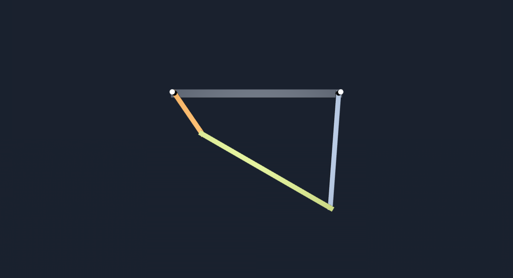
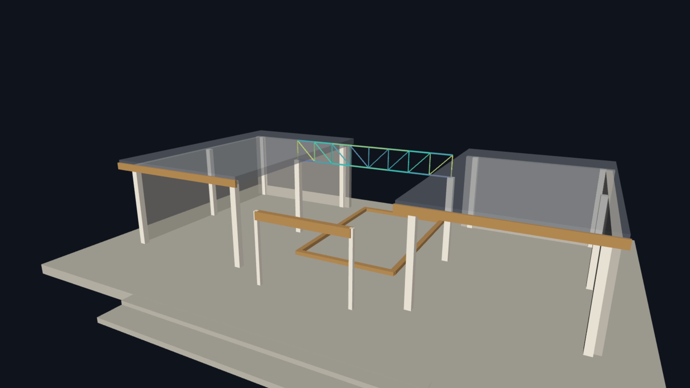

# Engineering under the Loom: the playbook

**28 November 2026.** For anything that makes an engineering claim behind an X3D scene: a part is strong enough, a mechanism reaches its positions, a building arrived whole from another format, a vehicle stays inside its envelope. It comes from two studies built under the Loom for this purpose, a **four-bar linkage stepped on three rigid-body engines** (source `[FBR]`, [x3d.engineering/fourbar/](x3d.engineering/fourbar/)) and an **IFC building with a roof truss designed across its court** (`[TRS]`, [x3d.engineering/ifc-truss/](x3d.engineering/ifc-truss/)). The laws it leans on are 15, 17, 19, 25, 28, 40, 42, 43 and 44 in [LOOM-v1.md](LOOM-v1.md); it adds no law. Its failure modes are 505 to 513, its profile is `x3d-engineering/v1`, and its card is [kit/templates/ENGINEERING-STUDY-CARD.md](kit/templates/ENGINEERING-STUDY-CARD.md).

Start from [SCIENCE-PLAYBOOK.md](SCIENCE-PLAYBOOK.md) when the subject is a numerical method, and from [PHYSICS-PLAYBOOK.md](PHYSICS-PLAYBOOK.md) when an engine steps the scene. This playbook adds what a *design* needs on top of both: a requirement, a margin, a named rule, and a list of what was lost on the way in.

**What is written and what is not.** The spine (section 2) and two chapters, Mechanical and Civil/AEC, are written from studies that ran. Six more disciplines have one page each (section 6) that names the first study that would pay for a chapter. Nothing in those six pages is a result.

Grades as in LOOM-v1.md: **C** measured here by the thread that built it, **L** read or reasoned, **S** suspected. Every number below is C on the rig named beside it unless marked. Under law 44 all of them stay Likely until someone who did not write them has recomputed them, and nobody has.

**Not for construction.** Both studies are worked examples. No licensed engineer has reviewed either. The truss is not a design anyone may build.

---

## 1. What engineering asks that science does not

Science asks whether a thing is true. Engineering asks whether it is enough, under which rule, by how much, and what happens when it is not. The scene witnesses (Grammar, Meaning, Traps) cannot answer any of the four, and neither can a physics run record: an engine that agrees with a closed form to six digits says nothing about whether the bar buckles.

| Claim | What can break it | Contract | Pattern |
|---|---|---|---|
| "It works" | no statement of what working means, so any result passes | numbered "shall" lines on the card, each with a check | E1 |
| "It is strong enough" | a match to a reference is reported where a margin was owed | demand, capacity and utilisation per member and per case, limit stated first | E2 |
| "It meets the code" | the clause was recalled, not read; the edition is unnamed | each clause carries its edition, where it was read, and a grade | E3 |
| "It is the same building" | counts match while parts are swapped, scaled or turned | joined by identity, quantities recomputed on both sides | E4, E5 |
| "Nothing was lost" | the converter drops what the target cannot hold and says nothing | every key on exactly one of two lists, carried or lost, both measured | E6 |
| "The solver is right" | one solver checked against itself | closed form, identity, second solver, each with a wrong twin | E7 |
| "It works at speed" | the design was run at one operating point | the claimed envelope is stated, probes beyond it are reported | E8 |
| "It is safe" | failures are listed with no order | a failure table, each row naming the requirement it breaks | E9 |

## 2. The spine: twelve patterns

Four are new with this playbook (E1, E2, E3, E9). Eight extend a law the Loom already had. The last column says honestly whether a study here paid for the pattern.

| # | Pattern | The rule | Extends | Paid for by |
|---|---|---|---|---|
| E1 | Requirement first | Every claim traces to a numbered "shall" on the card, and every "shall" has a check that can fail | new | `[FBR]` R1 to R6, `[TRS]` R1 to R7 |
| E2 | Margin, not match | Report demand, capacity and utilisation for a named case. The limit is on the card before the run | new | `[FBR]` R4, `[TRS]` R4 to R6 |
| E3 | Name the code and its edition | A clause is cited with edition, where it was read, and a grade. A clause from memory is S | new, after law 15 | `[TRS]` code table: 1 of 5 clauses L, 4 of 5 S |
| E4 | Units and frames are the interface | Unit, up axis and datum are declared in the file head and checked at every boundary | science pattern I | `[TRS]` millimetres to metres, Z up to Y up |
| E5 | Identity survives exchange | Parts are joined by their id, never by count or order | gate checklist, Truth | `[TRS]` 111 of 111 and 33 of 33 by GlobalId |
| E6 | Loss receipt per format | What the target cannot hold is listed and measured absent, not dropped | law 40 | `[TRS]` loss receipt; `[FBR]` loss report |
| E7 | Benchmark ladder | Closed form, identity, second solver, cross-implementation; each rung has a wrong twin | laws 25, 44 | `[FBR]` REF1 to REF6, `[TRS]` REF1 to REF6 |
| E8 | Sweep the envelope | State the range you claim. Run beyond it and report what happens | law 19 | `[FBR]` 1, 3, 10 and 30 rad/s |
| E9 | Failure table | Each known way to be wrong is a control that names the requirement it must break | new, after LOOM-v1 section 8 | 21 controls, 21 caught. Severity ranking: **not yet run** |
| E10 | As-operated replay | Recorded operation is replayed against the model and the first differing step is reported | law 42 | **Not paid.** Neither study has operating data |
| E11 | Independent check | A number is Likely until someone who did not write it recomputes it | law 44 | In part: second solvers and a second reader of the geometry. No second person |
| E12 | Configuration and a plain label | Pinned tools, a hash for every input and output, and a visible "not for construction" line | receipts | Both receipts; both cards carry the label |

### E1. Requirement first

A study with no requirement cannot fail, so it cannot pass either. The card carries numbered lines that begin "shall", and the witness has one gate per line.

The first draft of `[FBR]` R2 read "in every engine". Exploration then showed that one engine cannot hold the limit above 1 rad/s. Read as written, the *design* would have failed because of an *instrument*. The requirement was rewritten to say what was meant: at every speed in the claimed envelope, at least two independent engines hold the limit (failure mode 507). Writing the requirement down is what exposed the confusion.

### E2. Margin, not match

A reference match says the arithmetic is right. A margin says the design is enough. Both are owed, and they are different numbers.

| Study | Check | Demand | Capacity | Utilisation | Margin |
|---|---|---|---|---|---|
| `[FBR]` | coupler, Euler buckling (governs) | 2,238.0 N at crank 0° | 3,046.2 N with FS 2.0 | 0.735 | 0.361 |
| `[FBR]` | coupler, yield | 2,238.0 N | 37,500 N | 0.060 | |
| `[FBR]` | pin, double shear | 2,238.0 N | 7,255.2 N | 0.308 | |
| `[TRS]` | end vertical V0, compression (governs) | 43,737 N in LC2 | 79,309 N | 0.551 | 0.813 |
| `[TRS]` | diagonal D1, tension | 54,173 N in LC2 | 99,900 N | 0.542 | 0.844 |
| `[TRS]` | midspan deflection, D + Lr | 7.419 mm | span / 240 = 33.3 mm | span / 1078 | |

In `[FBR]` the coupler's yield check is at 6 % and looks like the answer. Buckling governs at 73 %, twelve times closer to the limit. A page that showed only the stress would have shown the wrong check.

### E3. Name the code and its edition

Law 15 says name the instrument behind every number. For a design the instrument is often a clause. `[TRS]` uses five, and when each was looked up, only one could be traced to a text:

| Clause | Used for | Read from | Grade |
|---|---|---|---|
| AISC 360 E3, flexural buckling | compression strength | course notes quoting the specification; the 360-22 text itself was not opened | L |
| AISC 360 D2(a), tensile yielding | tension strength | memory | S |
| AISC 360 E2 user note, KL/r of 200 | slenderness limit | memory | S |
| ASCE/SEI 7-16 2.3.1, combinations 1 and 3 | load factors | memory; a search for the 7-22 text returned a transcription in another form | S |
| L / 240 | deflection limit | memory of IBC Table 1604.3 | S |

So four of the five allowables behind a "passes" are Suspected. The arithmetic on top of them is checked to 1e-14; the inputs are not. That is the honest state, and the card says it clause by clause (failure mode 509). The one guard that does not depend on reading the code is an identity: the two branches of the E3 column curve must meet at the transition slenderness. With the constant 4.71 they meet to 3.8e-4. With the digits transposed to 4.17 they do not, and the control `transposed-471` is caught.

### E4 and E5. Units, frames and identity

An exchange is judged element by element, joined on the id, with quantities recomputed on both sides by different code.

- **Joined by identity.** 111 of 111 IFC products with geometry are found in the X3D by GlobalId, with equal name and class, and nothing extra. The truss repeats it: 33 of 33.
- **Counts cannot see a swap.** The control `swap-two-guids` exchanges the identities of two elements. Counts, names and classes still read 111 of 111. Only the per-element quantities catch it (failure mode 511).
- **Units.** The IFC is in millimetres (unit scale 0.001), the scene in metres. Read without the scale, the control fails R2. A truss computed in millimetres read as metres reports a utilisation of 7.6 million and a deflection of span / 36.
- **Frame.** IFC is Z up; the scene holds everything under one Transform `IFC_ZUP_TO_YUP` with rotation `1 0 0 -1.5707963267948966`. A reader that skips it fails R2.
- **Agreement.** Worst bounding-box difference 5.3e-6 mm, area 2.5e-8, volume 8.1e-9 (relative), between IfcOpenShell 0.9.0.post1 reading the IFC and this study's own reader of the X3D.

### E6. Loss receipt per format

Law 40 says report what the engine cannot honour. An exchange owes the same for a format. The rule: every kind of thing the source says is on exactly one of two lists, and both lists are measured. A key on neither list fails the gate.

| IFC says | In X3D | Measured |
|---|---|---|
| GlobalId, Name, class | MetadataString `guid`, `name`, `class` | equal on 111 of 111 |
| Pset_Bridge.Status | MetadataString `status` | equal on 111 of 111 |
| Pset_Bridge.Surface | the Appearance DEF, `Appearance_<surface>` | equal on 111 of 111 |
| Pset_Bridge.EditablePlacement | **lost** | present on 0 of 111 |
| Pset_Bridge.Role | **lost** | present on 0 of 111 |
| IfcSite, IfcBuilding, IfcBuildingStorey and the storey's Elevation | **lost** (no body) | 0 of 3 in X3D |
| IfcRelAggregates (3), IfcRelContainedInSpatialStructure (1) | **lost**: the scene is flat | |
| IfcExtrudedAreaSolid (29 bodies) | **lost as parameters**: triangles only | volume agrees to 8.1e-9 |
| source file | head meta `ifc:sourceSha256` | equals the IFC's sha256 |

Two of the four property keys on every element never arrived, and until this receipt was written nothing said so (failure mode 510). The geometry was perfect. That is the usual shape of the problem: the part a viewer can see crosses, the part an engineer needs does not.

### E7. Benchmark ladder

One rung is not a ladder. Each study climbs four kinds, and each rung has a wrong twin that must fail.

| Rung | `[FBR]` | Agreement | `[TRS]` | Agreement |
|---|---|---|---|---|
| Closed form | rocker angle by circle intersection | reference | method of sections: chord = M / h | 2.4e-16 |
| Second solver | Newton on the loop equation | 8.9e-16 | joint equilibrium against direct stiffness | 1.6e-14 |
| Identity | Freudenstein residual; power balance | 2.0e-15; 2.3e-14 | reactions equal loads; E3 branches meet | 1.7e-16; 3.8e-4 |
| Order, or a second route | velocity ratios against a central difference | 6.3e-11 | deflection by virtual work against stiffness | 1.4e-14 |
| Cross-implementation | three engines on one X3D file | see E8 | IfcOpenShell against this study's reader | 8.1e-9 |

The wrong twins: a crossed assembly branch, a Newton run on the wrong link, a flipped velocity sign, a stiffness matrix with the wrong sign, a method of sections with the wrong depth, a truss with one diagonal removed (the solver must say "35 unknowns for 36 equations", not return numbers). All caught.

### E8. Sweep the envelope

`[FBR]` claims 1 rad/s and probes 3, 10 and 30. An engine qualifies at a speed when rocker error is at most 0.5°, pin gap at most 1.0 mm and out-of-plane travel at most 5.0 mm (half the 10 mm gap between layers).

| Crank speed | Built-in | Rapier 0.21.0 | cannon-es 0.20.0 | Engines that qualify |
|---|---|---|---|---|
| 1 rad/s (claimed) | 0.013° / 0.08 mm / 2.20 mm | 0.0001° / 0.001 mm / 0.02 mm | 0.037° / 0.22 mm / 4.97 mm | 3 |
| 3 rad/s (probe) | 0.080° / 0.43 mm / **6.73 mm** | 0.001° / 0.008 mm / 0.18 mm | 0.213° / **1.11 mm** / **10.65 mm** | 1 |
| 10 rad/s (probe) | **0.584°** / **2.92 mm** / **17.0 mm** | 0.011° / 0.08 mm / 2.06 mm | **2.71°** / **8.31 mm** / **169 mm** | 1 |
| 30 rad/s (probe) | fails | 0.233° / 0.96 mm / **35.0 mm** | fails | 0 |

Cells are rocker error / pin gap / out-of-plane travel; bold is over its limit. Rig: Node v22.23.5, the bridge reader at x3d.loom 4a8dcd2, 240 Hz step sampled at 60 Hz.

The claim that survives is narrow and exact: at 1 rad/s three engines agree with the closed form. At 1 rad/s cannon-es passes the plane check with 0.7 % to spare, so even that claim is close on one instrument. Above it the design is unchanged and the instruments run out. A sweep is what separates the two.

### E9. Failure table

Every known way to be wrong is written as a control that names the requirement it must break, and the witness exits non-zero if any control survives. The two studies carry 21 controls (8 and 13), all caught.

The controls also show when a gate is carrying more than it seems. In `[TRS]`, dropping the pattern load case (live load on the west half only) does **not** change the governing utilisation. Strength still passes. The only thing that catches it is a coverage gate that checks which cases ran. Member D4 goes from tension to compression only in that case, and a different truss would have needed it.

What is not done: the rows are not ranked by consequence. An FMEA orders failures by severity, occurrence and detection. Here every row has detection (caught or not) and nothing else. That ranking is the next thing this pattern owes.

### E10 to E12

**E10, as-operated replay,** is not paid for here. The Loom has the machinery (a hash of every step, law 42; the PX4 flight log demo), and neither study has operating data to replay. It stays on the spine because every discipline in section 6 needs it.

**E11, independent check.** Inside one session the studies do what one author can: a second solver for each force and each deflection, and a different library for each geometry. A person who did not write them has not recomputed anything, so `second-reader` is `visible_not_run` on both receipts.

**E12, configuration and label.** Each study is accepted by `x3d.engineering/accept.sh` under `kit/profiles/x3d-engineering.json`, with the validator named (x3d_mcp fa4a8e3), a receipt, and a stale-witness control that must reject. `[FBR]` hashes its poses (`poses_sha256` 8c0fbc91…, identical on repeated runs). `[TRS]` writes a byte-identical IFC on every build (sha256 81f77e7f…) from GUIDs derived by hash.

## 3. The order of work

1. **Write the requirements** as numbered "shall" lines. If you cannot write the check beside a line, the line is not a requirement yet.
2. **Fill the card** ([kit/templates/ENGINEERING-STUDY-CARD.md](kit/templates/ENGINEERING-STUDY-CARD.md)): load cases, the envelope you claim, limits, each code clause with where you read it, and the two exchange lists. **Commit it before the run of record** (law 43). Exploring the worst case first is allowed (law 28); what it owes is a card that says so, limits derived from what the part must do, and the failing runs kept as reported probes (failure mode 508).
3. **References before scenes.** Closed form, identity, second solver. Run them with no engine and no file format in the loop.
4. **Controls with the references.** Write the wrong twin beside each check, and name the gate it must break.
5. **Qualify the instrument before judging the design.** An engine, a mesher or a converter is an instrument. Find where it stops holding your limits, and claim only inside that.
6. **Exchange.** Join by id. Recompute quantities on both sides with different code. Write the carried and lost lists and measure both.
7. **Margins.** Demand, capacity, utilisation, governing case, for every member. Report the governing one and the runner-up.
8. **Scenes through Grammar and Meaning**, including the ones only an engine reads.
9. **Accept, receipt, fold back.** `x3d.engineering/accept.sh <study>`; failure modes numbered from upstream's tip that day.

## 4. Chapter M: Mechanical

**The study.** A Grashof crank-rocker, a = 0.30, b = 0.90, c = 0.70, d = 1.00 m, steel bars 30 × 10 mm on 8 mm pins, resisting 1,200 N·m at the rocker. Six requirements, six references, eight controls. Result: **8 of 8 gates, 8 of 8 controls caught.**

*`scenes/fourbar-view.x3d` in X_ITE 16.5.1, Chromium 158 headless, software rendering (SwiftShader), no GPU. A viewing scene driven by the closed-form poses; no engine runs in it. The coupler's colour is its utilisation at that crank angle.*

**What the paper checks found.** Transmission angle stays between 49.99° (at crank 0°) and 108.03°, inside the 45° to 135° band. The coupler force peaks at 2,238 N at crank 0°, the same angle as the worst transmission angle, which is what the statics predicts (F = T / (c sin μ)). Buckling governs (section 2, E2).

**What the engines found.** See the table under E8.

**The finding worth the study: a hinge is not a crank pin.** The first scene used four `SingleAxisHingeJoint` nodes. In the built-in engine the crank turned about half a revolution and came back. More solver iterations made no difference. The cause is in the standard: X3D 4.0 clause 37.4.12 gives `minAngle` and `maxAngle` defaults of −π and π and says "A hinge may not travel more than π radians (or the equivalent angle base units) in either direction from its initial position." The built-in engine honours it. The Rapier and cannon-es adapters read the default range as "no stop" and write no note.

| Engine | Maximum hinge travel, four-hinge scene | Reading |
|---|---|---|
| Built-in | 3.1447 rad | stops at π, as the clause says |
| Rapier 0.21.0 adapter | 18.94 rad | turns freely; the stop is dropped without a note |
| cannon-es 0.20.0 adapter | 18.53 rad | turns freely; the stop is dropped without a note |

So the same valid file is a rocking linkage in one engine and a turning one in two others, and the engine that looked broken was the one following the standard (failure mode 505). The clause was read from the published specification on 27 November 2026. The study's fix is to pin the two full-turn joints with `BallJoint` and keep the four-hinge scene as a control. The adapters' silence is a law 40 loss and is in `results/loss.json`.

**The second finding: where the anchor sits.** With ball pins the mechanism first left its plane in all three engines (pin gap about 10 mm, tilt up to 1.5 rad). Pin B's anchor was 10 mm off the crank's own axis, which coupled the crank's free spin about its length to a tilt. Anchors on the bar's axis fixed it (failure mode 506). The measure that caught it honestly is out-of-plane travel in millimetres against half the layer gap, a limit that comes from the part and not from the run.

**X3D components this chapter uses:** RigidBodyPhysics (14 nodes), and for parts CADGeometry (6) and NURBS (13). **Not claimed:** friction, clearance, elastic bars, fatigue, a gear train, any CAD solid (STEP is not bridged).

## 5. Chapter C: Civil and AEC

**The study.** The Confluence building (`x3d.demo/docs/demos/confluence-ifc/v1/snapshot/model.ifc`, 500,619 bytes, IFC4) and its X3D scene, then a Pratt truss designed to span the court between two of its columns, written back out as IFC4 and X3D. Seven requirements, six references, thirteen controls. Result: **22 of 22 gates, 13 of 13 controls caught.**

*`scenes/truss-in-court.x3d` in X_ITE 16.5.1, Chromium 158 headless, software rendering (SwiftShader), no GPU. The grey building is context read from the IFC; the truss colour is each member's utilisation.*

**Part 1, the loss receipt.** 114 IFC products; 111 have a body and all 111 are in the X3D by GlobalId.

| IFC class | In IFC | In X3D by id | Parametric bodies meshed | Volume, m³ |
|---|---|---|---|---|
| IfcMember | 42 | 42 | 0 | 3.19 |
| IfcFurnishingElement | 25 | 25 | 15 | 17.64 |
| IfcColumn | 14 | 14 | 0 | 3.82 |
| IfcLightFixture | 8 | 8 | 8 | 0.07 |
| IfcBeam | 7 | 7 | 0 | 1.94 |
| IfcWindow | 6 | 6 | 6 | 2.12 |
| IfcWall | 4 | 4 | 0 | 38.43 |
| IfcSlab | 3 | 3 | 0 | 179.91 |
| IfcRoof | 2 | 2 | 0 | 53.84 |
| IfcSite, IfcBuilding, IfcBuildingStorey | 3 | 0 | no body | 0 |
| **All** | **114** | **111** | **29** | **300.95** |

Volumes are recomputed from the IFC bodies by IfcOpenShell; the per-element rows are in `results/loss-receipt.json`. What was lost is the table under E6: two property keys per element, the spatial tree, and the parameters of 29 extruded solids. The model has no IfcMaterial and no IfcMapConversion, so it carries no material data to lose and cannot be placed on Earth.

**Part 2, the truss.** The span is not typed. It is read from the IFC: columns `Column -4/1` and `Column 4/1` give 8.0 m at bearing level 4.1 m. Eight panels, 1.0 m deep, 18 joints, 33 members; chords SHS 60×60×4, webs SHS 40×40×3, Fy 250 MPa. Loads over a 5 m tributary width: dead 500 Pa plus self-weight (1,798 N), roof live 960 Pa.

| Case | Total load | Midspan deflection |
|---|---|---|
| LC1, 1.4 D | 30,517 N | 3.75 mm |
| LC2, 1.2 D + 1.6 Lr | 87,598 N | 10.80 mm |
| LC3, 1.2 D + 1.6 Lr on the west half | 56,878 N | 7.01 mm |
| SLS, D + Lr | 60,198 N | 7.42 mm = span / 1078 |

| Role | Members | Highest utilisation | Smallest margin |
|---|---|---|---|
| Vertical | 9 | 0.551 (V0 and V8, compression, KL/r 66.0) | 0.813 |
| Diagonal | 8 | 0.542 (D1 and D8, tension) | 0.844 |
| Top chord | 8 | 0.480 | 1.082 |
| Bottom chord | 8 | 0.407 | 1.456 |

Largest slenderness of any compression member is 93.3 against a limit of 200. Each member's demand, capacity, utilisation and governing case are written into the IFC (`Pset_LoomTruss`) and into the X3D (`MetadataSet` on each `CADPart`), and the witness checks all 33 in both files against the design bank, so no number in either file was typed.

**The assumptions that carry the result** (all on the card): pinned joints, loads at the panel points, K = 1.0 with the member length as the unbraced length, which means the top chord is taken as braced out of plane at every panel point. No connection is designed. No wind, snow, seismic or uplift case is run. Four of the five code clauses are Suspected (E3).

**What the validator taught.** The first truss scene passed the X3D 4.0 schema and failed Meaning with 34 errors, all one rule: x3d_mcp's `naming-convention` reports whitespace in any `name` attribute as illegal. On CADAssembly, CADPart and CADFace the X3D 4.0 object model that the validator itself ships types `name` as a plain SFString label. The rule and the object model disagree (C); which should change is a judgment (L, the rule). The shipped scenes use names without spaces, and the spaced original is kept as `controls/truss-spaced-names.x3d` so the count can be reproduced (failure mode 512). IFC names with spaces, such as `Column -4/1`, travel as MetadataString values, which the rule does not read.

**X3D components this chapter uses:** CADGeometry (6 nodes: the truss is a CADAssembly of 33 CADParts), Geospatial (11) once a model carries a map conversion. **Not claimed:** a frame with moments, a slab, a connection, a foundation, a second building, any real code check.

## 6. Six disciplines, one page each

None of these is a chapter. Each names what exists in the repos today, the references a study could hold itself to, and the one study that would pay for the chapter. "Exists" is from the survey of 27 November 2026 (x3d.loom 4a8dcd2 and seven sibling repos); node counts are tallied from `x3d.threejs/bridge/NODES.md` (260 nodes, 36 components).

### 6.1 Controls, modelling and simulation

- **Exists:** x3d.downey (seven rooms after Downey's book, failure modes 415 to 430, read from [LEARNINGS-downey.md](LEARNINGS-downey.md), L); [kit/templates/MODSIM-STUDY-CARD.md](kit/templates/MODSIM-STUDY-CARD.md); the Summit Duel controller.
- **Missing:** any feedback-control study. No step response, no stability margin. No file mentions FMI or SysML.
- **X3D components:** Followers (14 nodes). A Damper is a low-pass filter with a stated time constant, so the standard itself supplies a reference (L).
- **References that exist:** first- and second-order step responses in closed form; gain and phase margin from the open-loop transfer function.
- **First study:** a PID loop on a known second-order plant, margins as requirements, drawn with Followers, with a second solver for the response.
- **Spine patterns it will stress:** E2 (a stability margin is a margin), E8 (gain sweep), E10 (replay a recorded response).

### 6.2 Robotics

- **Exists:** the MuJoCo authoring bridge (one arm under a bounded profile), the PhysX H-Anim ragdoll, Newton 1.8 in x3d.nvidia (9 exact references, 3 negative controls), the Open3D-ML bridge.
- **Missing:** URDF is a plan line. The MCAP reader decodes ROS 1 only. No kinematics witness, no sensor model.
- **X3D components:** RigidBodyPhysics (14), HAnim (6), Picking (5).
- **References that exist:** forward kinematics in closed form; a Jacobian by finite difference; a second engine on random poses.
- **First study:** one open URDF arm to X3D joints, every link name surviving the round trip (E5), reach and joint limits as requirements (E1), a loss receipt for what URDF says that X3D cannot hold (E6).
- **Carry over from chapter M:** the hinge clause. A revolute joint that must turn past π cannot be a SingleAxisHingeJoint.

### 6.3 Aerospace

- **Exists:** one PX4 quadrotor flight log turned into an X3D scene with replay (`x3d.demo/docs/demos/drone-flight-3d/v1`; the raw log was removed for GPS privacy). Orbit work exists as science only.
- **Missing:** aerodynamics, orbit design, any vehicle model.
- **X3D components:** Geospatial (11), RigidBodyPhysics (14), NURBS (13) for surfaces.
- **References that exist:** two-body Kepler orbit and vis-viva, the rocket equation, a Hohmann transfer, the standard atmosphere table.
- **First study:** a transfer orbit in GeoLocation held to the closed form with a delta-v budget as the requirement, then the flight log replayed against a simple vehicle model (E10).

### 6.4 Networked simulation (DIS)

- **Exists:** all 6 DIS nodes are parsed and receipted in the three.js bridge. X_ITE marks the component not supported: fields are stored and nothing is sent or received. No PDU has crossed a wire here.
- **X3D components:** DIS (6), Geospatial (11).
- **Standard to name (E3):** IEEE 1278.1, with its year, read from the text and not from memory.
- **References that exist:** a recorded PDU stream decoded byte for byte by a second library; dead-reckoning error against the true path at a stated update rate.
- **First study:** a WebSocket gateway, an EspduTransform that actually moves, a hashed replay of the PDU log (law 42), with the update rate and the position error as requirements.

### 6.5 Electrical and electronics

- **Exists:** nothing that is a circuit. The Loom files that match "circuit" are racing circuits in a driving game. Adjacent only: Wire Lab (signal-flow graphs), Living Heart (excitable media).
- **X3D components:** CADGeometry (6; CADLayer for board layers), Sound (21) for signal graphs.
- **References that exist:** RC and RLC step responses in closed form; Kirchhoff's laws as exact discrete identities; ngspice as the second solver.
- **First study:** one open KiCad board to X3D with every reference designator kept (E5) and a loss receipt per layer (E6), then one filter held to its closed form with component tolerances as the envelope (E8).

### 6.6 Underwater and marine

- **Exists:** nothing. No markdown file in the eight repos surveyed mentions underwater, AUV, submarine or sonar.
- **Why it is on the list:** X3D's own engineering lineage runs through it. Don Brutzman's Naval Postgraduate School dissertation, "A Virtual World for an Autonomous Underwater Vehicle" (December 1994), used DIS for live interaction, and the NPS AUV Workbench later paired X3D views with DIS and mission files. Both facts are from search summaries read on 27 November 2026 and not opened page by page (L).
- **X3D components:** RigidBodyPhysics (14), Geospatial (11), DIS (6), Sound (21).
- **References that exist:** Archimedes buoyancy (exact); terminal velocity under quadratic drag; Snell's law for sound rays.
- **First study:** a tank test. A neutrally buoyant body in six degrees of freedom with trim and depth-keeping as requirements, broadcast and replayed over DIS, which makes it the natural second study after 6.4.

## 7. The card, the profile and the witness

| Piece | Where | What it holds |
|---|---|---|
| Card | [kit/templates/ENGINEERING-STUDY-CARD.md](kit/templates/ENGINEERING-STUDY-CARD.md); each study's `card.json` | requirements, load cases, envelope, limits, code clauses with grades, the two exchange lists, controls |
| Profile | `kit/profiles/x3d-engineering.json` (`x3d-engineering/v1`) | grammar, meaning, traps, and a `requirements` witness; four witnesses visibly not run |
| Witness | each study's `check.py`, run by `kit/loom command --name requirements` | exit 0 only when every gate passes and every control is caught |
| Runner | `x3d.engineering/accept.sh fourbar` or `ifc-truss` | build, witnesses, accept, receipt, stale-witness control |

There is no `kit/loom engineering` subcommand. The `requirements` witness is the study's own script run through the kit's generic command adapter, so the kit proves the script ran green on this exact candidate and nothing more. A kit witness that reads a `loom.eng-card/1` and checks that every requirement has a gate and every control names one is the obvious next piece, and it is not built.

## 8. Where the evidence is

| Pattern or finding | Files |
|---|---|
| Requirements and limits (E1, E2) | `x3d.engineering/fourbar/card.json`, `ifc-truss/card.json`; the first commit of each study holds the card and no results |
| Code clauses with grades (E3) | `ifc-truss/card.json` `codes` |
| Exchange and loss (E4 to E6) | `ifc-truss/loss_receipt.py`, `results/loss-receipt.json`, `results/truss-roundtrip.json`; `fourbar/results/loss.json` |
| Ladders (E7) | `fourbar/fourbar.py`, `check.py`; `ifc-truss/truss.py`, `check.py` |
| Envelope (E8) | `fourbar/results/verdict.json` (`engines`, `probes`), `run_engines.js` |
| Controls (E9) | each `results/verdict.json` `controls`; `fourbar/scenes/mutant-*.x3d`, `control-four-hinges.x3d`; `ifc-truss/controls/` |
| Hinge clause | `fourbar/results/verdict.json` `hinge_stop`; `scenes/control-four-hinges.x3d` |
| Validator and the name rule | `ifc-truss/results/validator-note.json` |
| Receipts | `runs/engineering-fourbar-20261128/`, `runs/engineering-ifc-truss-20261128/` |
| Stills and their rig | each study's `stills/rig.json` |

## 9. Open

- **A second reader.** Nobody outside the session has recomputed a number. Every C here is Likely under law 44 until one does.
- **Four code clauses are Suspected.** Someone with the AISC 360 and ASCE 7 texts should confirm or correct the five lines in the code table. Until then the truss "passes" a set of rules that were partly recalled.
- **Severity.** The failure table is not ranked (E9).
- **Operating data.** No as-operated replay in either study (E10).
- **The adapters' hinge stop.** Rapier and cannon-es adapters drop `minAngle` and `maxAngle` silently. The fix belongs in the bridge reader, with a note when a default stop is not applied.
- **The validator's name rule.** Whether `naming-convention` should skip `name` fields the object model types as SFString is a question for x3d_mcp.
- **A real GPU, a second browser and a paired visual review** are `visible_not_run`. The stills are a look at the scenes, not a witness.
- **`[FBR]` changed a measure and narrowed its claim after exploration.** The card says so, the limits are derived from the part, and the failing probes are kept. That the limits were not fitted to the numbers is the author's word (S).
- **Six disciplines** have a page and no study.
