# R2R: the receipt-to-rule engine (v0.1, 23 November 2026)

**What it does.** The Loom's tools leave receipts when something breaks: a chaos round's crash rows, a validator's
verdicts, a planted fault. R2R reads those receipts and writes **candidate rules**: short statements in a fixed
vocabulary that say which files will break which tool. Then it does what a rule written by hand rarely gets: it
builds files the tool has never seen, predicts the outcome, runs the tool, and grades the rule by whether the
prediction came true.

**In one line.** A failure pays rent once (law 7); R2R is the machine that collects it.

**Explained simply.** A tool crashed on 61 files. Somewhere in those files is the thing that crashes it. R2R lines each
crashing file up against the clean file it was cut from and asks "what is different?". It writes the answer down as a
rule. Then it plays twenty questions with the tool: "if I put this value there, will you crash?" Every wrong guess
sharpens the rule. At the end it sets one last quiz the rule has never seen, and the grade is the quiz score.

No language model is used anywhere in v0.1, and none is needed for what is measured below. Where a model would help,
the engine says so in a work list, and the seam for one is drawn (section 12).

Code: `kit/loomkit/r2r/` (standard library only). Tests: `kit/tests/test_r2r.py`. Sealed runs: `runs/r2r-*`.
What was learned building it: [LEARNINGS-r2r-engine.md](LEARNINGS-r2r-engine.md).

---

## 1. The loop

```mermaid
flowchart LR
  R[Receipts<br/>chaos rows, verdicts,<br/>planted faults] --> E[Failure events<br/>instrument, outcome,<br/>signature, twin]
  E --> C[Clusters<br/>one per instrument<br/>and signature]
  C --> I[Induce<br/>difference to the twin,<br/>fence, set cover]
  I --> P[Probe<br/>plant one edit in a clean host,<br/>predict, run the tool]
  P -- surprises go back in as receipts --> I
  P --> A[Audit round<br/>not fed back]
  A --> V[Prove<br/>both sides, ablation,<br/>held-out, degenerate]
  V --> G[Grade<br/>C, L or S by a fixed table<br/>and closure beside it]
  G --> S[Sealed run folder<br/>candidates, probes, report]
  S --> H((A person<br/>promotes or declines))
```



| Step | Module | What goes in | What comes out |
|---|---|---|---|
| Read | `adapters.py`, `events.py` | a receipt family | `loom.failure-event/1`: who ran what on which file, and what happened |
| Cluster | `events.py` | events | groups by (instrument, signature) |
| Induce | `induce.py` | one cluster and every file the same instrument passed | rules, alternates, residue, a search trace |
| Probe | `probe.py`, `plant.py`, `oracles.py` | a rule, clean host files, the instrument | new receipts; rules refined until a round changes nothing; one audit round |
| Prove | `prove.py`, `known.py` | a rule and all receipts | `loom.rule-proof/1` |
| Grade | `grade.py` | a proof | C, L or S with the reasons, and closure |
| Seal | `engine.py`, `report.py` | everything | a run folder that is never overwritten |

The engine never promotes. Every candidate is written with `"status": "candidate"` and `"promoted": false`, and there
is no code path that changes either.

## 2. Words

| Word | Meaning here |
|---|---|
| Instrument | A named tool at a named version: `x3d-blender-io 2.7.1 importer (bpy 5.3.0)`. Every count is relative to one (law 15). |
| Receipt | What a run of an instrument left behind. R2R needs both halves: the files that failed and the files that passed. |
| Event | One instrument, one file, pass or fail. A failure carries a signature and may name a twin. |
| Signature | The kind of failure with the specifics stripped: `IndexError at import_x3d.py:860 getFieldAsBool`. |
| Twin | A file the instrument passed that differs from the failing one by one edit. |
| Site | One place in a file: an attribute, an element, or the file as a whole. |
| Literal | One fact about a site, as a short string: `v:bool_noncanonical`, `at:Box@solid`, `ge:depth_max:1004`. |
| Rule | One site, a few literals that must all hold, and at most one list of places of which one must hold. |
| Fence | The places a rule is allowed to fire: the list of node and attribute pairs where a failure was actually seen. |
| Probe | A clean host file with one planted edit, run through the instrument to test a prediction. |
| Audit | The last probe round. Its results are not fed back, so the rule was fixed before those files existed. |
| Grade | C Confirmed, L Likely, S Suspected: a statement about evidence, never about how convincing a rule reads. |
| Closure | Whether failures of the same signature exist that no rule fires on. Reported beside the grade. |

## 3. Receipts it reads

| Adapter | Reads | Who says it failed | Twin |
|---|---|---|---|
| `chaos` | `rows.json` and `mutants/` of x3d-blender-io `tools/chaos/differential.py` | a tool: importer, import then export, a judge that crashed | the seed the mutant was cut from |
| `verdicts` | one JSON line per file from any oracle driver | a tool | optional |
| `faultlab` | the Fault Lab's `cases.json` (x3d.demo) | a person who planted the fault (`authored`) | the clean scene |
| `events` | `loom.failure-event/1` lines from anywhere | as stated per line | optional |
| `failures` | `loom.failure/1` records (glTF lane) | a tool | none |

Events carry `observed`: `tool`, `authored` or `model`. The grade table reads it: a failure a person authored cannot
earn C, and a failure a model reported cannot earn more than S.

Not read yet: `loom.rejection/1`, x3d.zod disagreement receipts, loss receipts, X_ITE render gaps. Each needs an
adapter of about forty lines and, for probing, a driver (section 11).

## 4. The vocabulary

A file becomes a list of sites, and each site a set of literals. The literals come from the X3DUOM (267 nodes, 4,342
field rows, read once into `r2r/data/uom-facts.json`), so "this value does not have its type's form" or "this index
runs past its list" are things a program checks, not things a model guesses.

| Tier | Kind | Examples | A rule resting on it |
|---|---|---|---|
| 1 | Structural facts the X3DUOM decides | `v:lexical_invalid`, `v:out_of_range`, `v:index_out_of_range`, `v:use_undefined`, `x:sfnode_multiple`, `x:misfiled` | can earn C |
| 2 | The shape of a value, and thresholds on numbers | `v:nonfinite`, `v:has_comma`, `ge:depth_max:N`, `ge:index_excess:N` | can earn C |
| 3 | Surface patterns | a URL's scheme, a file type | can earn C |
| 4 | The literal value itself | `v:eq:TRUE`, `v:tok:1e40` | is a fingerprint: S, and flagged as a vocabulary gap |
| context | Where, not why | `at:Box@solid`, `n:Transform`, `p:Shape`, `e.child:Coordinate`, `anc:HAnimHumanoid` | narrows a test; never a reason by itself |

X3D is close to a grammar for scenes, and the X3DUOM writes that grammar down as data. That is why this works without
a model: the words a rule needs already exist and each has a decision procedure.

## 5. The rule language

```
attr[v:bool_noncanonical & !v:case_variant & nws:1 & (at:Box@solid | at:IndexedFaceSet@solid | at:DirectionalLight@global)]
```

reads "at one attribute: a boolean is spelt as something other than `true` or `false`, and it is not just a change of
case, and the value has one space-separated part, at one of these three places". The whole language is: one site kind
(`attr`, `elem`, `doc`), literals joined by AND, `!` for NOT, `ge:`/`le:` for a threshold, and one optional OR-list.
A rule has a content address (`r2r-` and 12 hex digits of its canonical JSON), so the same rule has the same id on any
machine. Forty lines of code run it (`rule.py`), and it renders itself as a sentence.

It is this small on purpose. Every rule can be read aloud and checked by hand against a file. A candidate that needs
more than the language can say is marked as a vocabulary gap and waits for a person or a proposer to name the idea.

## 6. Induction

1. **Difference.** Each failing file is compared with its twin. Sites are matched by content first, then by address,
   so an inserted element does not make everything after it look changed. The changed sites are the only places a rule
   may claim to explain the failure.
2. **Seeds.** Every new test literal, lost attribute or child, and changed number at a changed site is a seed. A
   threshold is offered at the value that takes in all of the failures that moved that number, three quarters of them,
   or half, and is counted by what it takes in. Thresholds need at least 30 passing files to compare with.
3. **Fence.** The rule is fenced to the places where failures were seen: one place, or a list of up to 64. It claims
   nothing about a node or attribute where no failure was observed (law 32's lesson, section 13).
4. **Search.** Each seed is specialised by a beam search that adds one literal at a time, scored by how many passing
   files the literal removes for how many failures it keeps. Literals are budgeted by evidence:
   `min(7, 1 + ceil(log2(n + 1)))` for n failures. Idle literals are pruned afterwards.
5. **Cover.** Rules are chosen greedily: real vocabulary before fingerprints, most failures newly explained, causes
   before incidental numbers (file size, value length), fewest literals, narrowest reach. A later rule must newly
   explain at least 2 failures and 5% of the cluster. What is left is **residue** and is reported.
6. **What it could not decide.** Alternates that explain the same failures, the unfenced reading and its false alarms,
   the untested stretch of every threshold, and strays into other signatures (at 80% the two signatures are flagged
   as one root cause).

A failure that is byte-identical to a file the instrument passed has its cause outside the file. R2R says so and
writes no rule for it.

## 7. Probing

A rule induced from receipts is a guess about a tool. The honest test is to ask the tool.

| Probe | Where | Value | The rule predicts | It answers |
|---|---|---|---|---|
| `confirm` | inside the fence, on a file never seen | copied verbatim from a real failure | fail | does the rule hold on new files? |
| `widen` | just outside the fence | the same | pass (the unfenced rule says fail) | is the fence too tight? |
| `value` | a site just seen to be live | a variant the rule still fires on | fail | does the value test generalise? |
| `near` | a live site, or one step under a threshold | a variant the rule does not fire on | pass | is the boundary where the rule says? |
| `alternate` | a live site | a variant on which the rule and an alternate disagree | either | which reading is right? |
| `bisect` | inside a threshold's untested stretch | a midpoint | nobody knows | where exactly is the limit? |

**The design is factorial, and that matters.** A tool only fails where it actually reads. "This spelling is harmless"
and "the importer never looks at this attribute" are the same observation unless place and value are tested apart.
So place probes carry a value that really failed, and value probes are planted only at a site where a place probe has
just failed. The first prober did not do this and shattered one rule into a pile of fingerprints.

Results go back in as ordinary receipts and induction runs again, up to three rounds or until a round changes no rule
and holds no surprise. Then the audit round runs and is not fed back. Every probe has a twin (its host, written by the
same serialiser), and a host that fails the instrument on its own gives no verdict. A probe can also fail in a way no
receipt showed; that is a new cluster, and it gets its own turn.

Every probe is stored as a recipe: host name and hash, and one edit (`["set_attr", path, attribute, value]`,
`["deepen", n]`). `plant.apply` rebuilds it to the byte, so a run stores no probe files and any probe can be replayed
against another version of the instrument.

## 8. The proof

`loom.rule-proof/1` records, for one rule and one instrument: source failures explained at the changed site;
false alarms on every file the instrument passed; held-out receipts (other random seeds, other files, split by content
hash so the same bytes are never on both sides); audit probes confirmed, refuted and missed; each probe round's tally;
ablation of every literal; a battery of eight degenerate files; alternates; threshold intervals; the tier-1 literal
every explained failure shares (the normative reading); and whether an existing hand-written Loom trap already catches
the same files. A proof never says a rule is true. It says what was run, on what, and what came back.

## 9. Grades

| Grade | Requires | Typical reason for not getting it |
|---|---|---|
| **C** Confirmed | failures observed by a tool; sources explained; 0 false alarms on at least 30 passing files; and unseen confirmation: at least 5 audit probes confirmed with none refuted, or at least 5 held-out failures with 90% caught and no held-out false alarm | |
| **L** Likely | clean on everything induction saw | no oracle, too few held-out failures, fewer than 30 passing files, or the failures were authored by a person |
| **S** Suspected | anything else | a false alarm, a refuted prediction, a fingerprint, a degenerate firing, one failure with no probe, a sliver of a large cluster with no probe, failures reported by a model |

**Closure** stands beside the grade: `open` (the audit or the held-out set holds failures of this signature that no
rule fires on), `closed-so-far` (at least 5 probes outside the rule all passed), or `untested`. A rule can be
Confirmed and open: every time it fires it is right, and it does not yet fire everywhere it should.

A grade is about one instrument at one version. `r2r replay` asks a newer version about an old run's rules and
answers `closed`, `partly closed`, `still live` or `not exercised`. A closed rule is retired for the new version and
kept as a regression test.

## 10. The sealed run folder

| File | Schema | Holds |
|---|---|---|
| `manifest.json` | `loom.r2r-manifest/1` | every input of the run: receipts, roots, oracles, settings, notes |
| `run.json` | `loom.r2r-run/1` | inputs with hashes, instruments and counts, the kit's fingerprint taken when the run began, the proposer |
| `candidates/<id>.json` | `loom.rule-candidate/1` | the rule, its sentence, its proof, its grade, up to 200 sources with file hashes and receipt rows; and under `also_explains` one more claim (instrument, signature, proof, grade, sources) for every further signature the same rule explains |
| `clusters.json` | | every cluster: its rules, residue, best unclean efforts, same-root-cause hints, the search log |
| `probes.jsonl` | | every probe: host, recipe, what the rule said, what the instrument did, the verdict |
| `events.jsonl.gz` | `loom.failure-event/1` | every event read or made |
| `REPORT.md` | | the same facts for a person deciding what to promote |

The engine refuses to write into a folder that has content. If the kit's source changes while a run is going, the run
says so in its notes and should not be cited.

**One rule, one candidate.** A rule's id is the hash of its content, so two crash signatures with one cause (two lines
of one function) arrive at the same id. The candidate is then one file with two claims, each proved and graded against
its own signature. `run.json` counts distinct rules under `candidates`, graded by their first claim, and rule-signature
pairs under `claims`. The first full run on real receipts did this wrong: it overwrote the first proof and counted the
rule twice (LOOM-v1 failure mode 196).

## 11. Command line and drivers

```
kit/loom r2r run      MANIFEST --out DIR [--only TEXT] [--no-probe] [--rounds N] [--root NAME=PATH ...]
kit/loom r2r events   MANIFEST [--out FILE]
kit/loom r2r show     RUN_DIR [RULE_ID]
kit/loom r2r check    RUN_DIR FILE ... [--min-grade C|L|S] [--json]      exit 1 when a rule fires on a file
kit/loom r2r replay   RUN_DIR MANIFEST --out FILE [--map OLD=NEW ...]    exit 1 when a rule is still live
kit/loom r2r needs    RUN_DIR
kit/loom r2r brief    RUN_DIR RULE_ID
kit/loom r2r selftest [--seed N] [--only NAME] [--keep DIR] [--json]     exit 1 when the engine fails its own test
```

Exit 2 always means a manifest, a run folder or an instrument could not be used.

`replay` asks one question per distinct file: what the new version's own receipts say about files the rule fires on,
and then, of the new version directly, the old failures and the confirmed probes its receipts have not answered
(rebuilt from their recipes and checked against their recorded hashes). The two counts never share a file.

`check` is the first practical use: the candidates of a run become a pre-flight check that says "this file will make
that tool fail with this signature, here". It is a candidate rule's prediction, not a validator's verdict, and says so.

**An instrument joins by a driver.** A driver reads a list of files and writes one JSON line per file:
`{"file", "outcome": "pass" | "fail" | "skip", "signature", "seconds"}`, in order, flushed after each. If the
instrument takes the process down, the driver just dies; R2R charges the death to the first file without a verdict and
starts a new process for the rest. `drivers/blender_io.py` drives the Blender add-on (import, import then export,
x3d.py) inside bpy under a memory cap. `drivers/rule_tool.py` is a stand-in whose "tool" is a rule; it is the shortest
complete example and is what the tests use.

## 12. The seam for a language model (designed, switched off)

The DSPy sweep of 18 November found that the hard part of rule synthesis with a model is the metric, not the writing:
degenerate batteries, lawful near-misses, content-hash splits, an oracle that does not mark its own homework. R2R is
that metric, and it does not care who proposed the rule. So a model plugs in as a second **proposer** and nothing
else changes (`proposers.py`).

| Piece | In the code | For a DSPy program it is |
|---|---|---|
| What the model is shown | `proposers.brief(candidate)` and `r2r brief` | the input fields: signature, current rule, proof, and the counterexample probes as text |
| What it may return | `proposers.validate_proposal(json)` | the output field: one rule in the rule language; anything else is refused |
| The score | `proposers.score(proof, grade)` | the metric for MIPROv2 or GEPA: grade, then confirmed minus refuted probes, then false alarms |
| The feedback | the refuted and missed probes of the proof | the textual feedback GEPA asks for |
| Where a model is wanted | `proposers.needs_a_proposer(...)` and `r2r needs` | the training set: vocabulary gaps, residue, open closure |
| The socket | `proposers.DSPyProposer` | refuses to run until a person turns it on |

What a model may never do here: grade, promote, change a proof, or see held-out receipts. A rule it proposes is proved
by the same probes as any other, and a model's reading of which law a rule falls under stays S until the owner
confirms it.

## 13. Which laws this serves

| Law | How R2R serves it |
|---|---|
| 7. Every mistake pays rent once: incident, fact, rule with tests | It is the step from incident to rule, and the rule arrives with its tests on both sides. |
| 15. Name the instrument behind every number | An event without an instrument and version cannot be written; every grade names its instrument. |
| 19. A control must fail for the intended reason | A probe that fails with another signature is counted as `other-failure`, never as a confirmation. The engine's own tests expect exact diagnostics. |
| 44. A check is shown able to fail; a number is not Confirmed until a second reader has tried to break it | The audit round is the second reader. The self-test hides a rule and also hands the engine pure noise. |
| Law 32's lesson (x3d.loom #150 and #151) | Four failure rows had been marked as falling under law 32 on a model's reading and were struck. So here a rule never claims a place where no failure was seen (the fence), and a model's say-so can never be graded above S. |
| F3 of the ontology review (receipts held only survivors) | R2R cannot run without the passing half, and reports how many passing files each rule was tested on. |

## 14. What it does not do

- **One site per rule.** A cause that needs two places at once ("this index against that list" is built in as a
  literal; "this node's field against that other node's field" in general is not) cannot be written.
- **Words it lacks stay lacking.** When the true cause has no literal, induction falls back to fingerprints, grades
  them S and lists the gap. It does not invent vocabulary.
- **It learns the instrument, not the standard.** A Confirmed rule says a tool fails, not that a file is invalid X3D.
  The proof's normative reading shows when both coincide.
- **Thresholds can be the machine's.** A limit that is really a memory cliff is the cliff of the memory cap the
  probes ran under. The run's notes say what the cap was.
- **Signatures are given, not learned.** If an adapter lumps two failures under one signature, the cluster shows it
  as several rules and residue; if it splits one cause over two signatures, the stray counter flags it.
- **Small clusters swell under probing.** One real failure plus three rounds of probes can become a hundred probe-born
  failures with several overlapping rules. Each is graded on its own evidence, and closure says what is still open.
