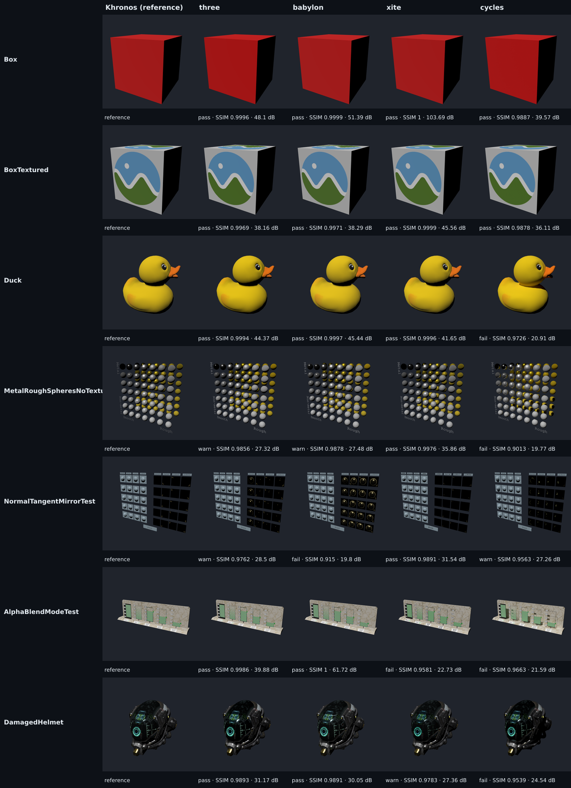

# formats/gltf: the Loom for glTF 2.0

**Gate → harness → reference → engines → score → receipt**, the x3d.loom method applied to a second format, plus a semantic witness that carries X3D meaning (Metadata, IFC, CIDOC-CRM, PROV-O) through glTF and checks it on the way back. The scope, the stage map, where "correct" is pinned and the first results are in **[SPEC.md](SPEC.md)**.



| stage | tool (version) | file |
|---|---|---|
| corpus | Khronos glTF-Sample-Assets @ `f0920f5`, 7 assets, sha256-pinned | `corpus/manifest.json`, `tools/fetch-corpus.mjs` |
| gate | Khronos glTF-Validator 2.0.0-dev.3.10 | reused: `../../x3d.gltf/src/validate.mjs` |
| harness | glTF-Transform 4.5.1: + camera + one `KHR_lights_punctual` 2.5 lux sun | `src/harness.mjs` |
| reference | Khronos glTF Sample Renderer 1.1.0 (`@khronosgroup/gltf-viewer`), IBL off, tone map none | `pages/khronos.*`, `src/reference-khronos.mjs` |
| engines | three.js r187, Babylon.js 9.32.0, X_ITE 16.7.1 (glb via X3D `Inline`), Blender 5.3.0 Cycles (`bpy` wheel); x3d.wgpu listed `not_run` | reused: `../../x3d.gltf/render/`; `blender/cycles_render.py` |
| score | PSNR, PSNR-fg, SSIM, IoU after matching the display encode; consensus across engines | `src/score.mjs`, `src/encode.mjs` |
| semantic | X3D → glTF (KHR_xmp_json_ld) → X3D, rules S0-S7 | `semantic/x3dsem.py` |
| receipt | `loom.render-receipt/1`, sealed sha256, never overwritten | `schema/`, `src/receipt.mjs`, `tools/check_receipts.py` |

```bash
cd ../../x3d.gltf && npm ci && cd ../formats/gltf && npm ci     # engines live in the sibling lane
pip install bpy==5.3.0 pillow numpy jsonschema                    # optional: Cycles row (Python 3.13); else it is not_run
node tools/fetch-corpus.mjs                                       # fetch + sha256-check the 7 assets into corpus/cache/
node bin/loom-gltf.mjs run --out runs/my-run                      # ~6 min on 4 CPU cores, no GPU
node bin/loom-gltf.mjs run --x3d a.x3d,b.x3d --out runs/my-sem    # semantic round trip + visual Loom on the converted glb
node tools/contact-sheet.mjs runs/my-run
python3 -I tools/check_receipts.py runs/my-run                    # schema + seal of every receipt
npm test && python3 -I semantic/test_x3dsem.py                    # 7 + 11 tests, every witness must be able to say no
```

Set `LOOM_BPY_PYTHON` to a Python that has `bpy`, `numpy` and `PIL` if it is not `python3`.
