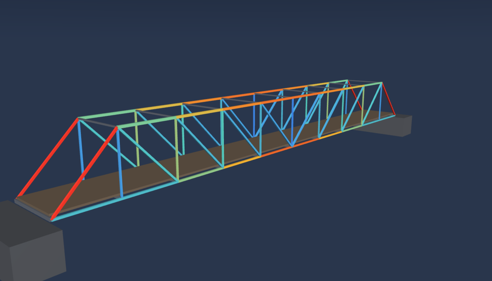

# x3d.engineering/footbridge

Study D of [ENGINEERING-PLAYBOOK.md](../../ENGINEERING-PLAYBOOK.md) (28 November 2026): a 30 m steel Pratt truss footbridge under a moving crowd. **A worked study, not for construction.** No licensed engineer has reviewed it; eight of ten code lines are recalled or chosen (graded on the card). Every number is measured by the thread that built it and stays Likely until a second reader recomputes it (law 44).



## What it answers

| Question | Answer | Where in `results/bank.json` |
|---|---|---|
| Where must the crowd stand to hurt each member most? | On the lengths of deck where that member's influence line has one sign. 8 of 37 members reverse under a part-loaded deck; 0 do under a full one. The midspan diagonal D5 sees +74.5 and −37.0 kN where a full deck shows +31.9 kN | `influence`, `patterning`, `members` |
| What sections does it need? | Top chord 120 × 6, bottom chord 100 × 5, end posts 100 × 6, verticals 80 × 4, diagonals 100 × 5 mm square hollow. End post governs at 0.996 | `sections`, `governing` |
| How far does it sag? | 39.0 mm under the full crowd, span/770 against a limit of span/360. Strength governs | `deflection` |
| Will footfall excite it? | 4.02 Hz empty, above the 3 Hz line. 2.26 Hz with the design crowd's mass on it, inside walking pace | `frequency` |
| What does depth buy? | Stiffness and frequency, not steel: 2 m to 4 m deep moves frequency 3.18 to 4.51 Hz and steel 1,825 to 2,389 kg with no trend | `probes.depth` |

Result: **17 of 17 gates, 14 of 14 controls caught** (`results/verdict.json`). Receipt: `runs/engineering-footbridge-20261128/`.

## Run it

```sh
export LOOM_FORK=/path/to/x3d_mcp           # the validator checkout
pip install numpy openseespy                # openseespy 3.8 is the independent solver
x3d.engineering/accept.sh footbridge        # about two minutes; needs Node 22 for the page solver check
```

## Files

| File | What |
|---|---|
| `card.json` | 7 requirements, 9 references, 10 code lines with grades, 14 controls and the limits, committed before any result; one dated amendment where a prediction was wrong |
| `footbridge.py` | geometry, joint equilibrium as one matrix, stiffness method, influence lines, Müller-Breslau, patterned areas, envelope, sizing, deflection, mass and frequency, the OpenSeesPy model |
| `build.py` | every stated number into `results/bank.json`, and the two scenes |
| `scenes.py` | X3D 4.0 writers and the reader that joins a scene back to the bank |
| `check.py` | the witness: every gate recomputed, every control required to fail the gate it names; writes `results/verdict.json`, `results/loss.json` |
| `page/solver.js`, `page_solver_check.js` | the teaching page's own statics in JavaScript and its check against the bank (`results/page-solver.json`) |
| `page/` | the teaching page: `template.html` + `app.js` + `solver.js` assembled by `build_page.py`, every quoted number copied from the bank and the verdict |
| `scenes/footbridge.x3d` | the design; each member of the near truss carries 13 numbers and labels as metadata |
| `scenes/footbridge-walk.x3d` | a crowd filling the deck from the left, member colours keyed from 21 static solutions |

## Things worth knowing

- **Loads from AASHTO, strength from AISC 360.** A choice for this study so the strength formulas are the ones already checked in the roof truss study. A real design uses one code throughout.
- **A plane model of one truss.** Nothing here covers wind, lateral vibration or lateral crowd lock-in, fatigue, connections, bearings, the deck or the foundations. The top chord is assumed braced at every panel point by overhead bracing that is not designed.
- **Members are drawn as solid boxes of the section's outer width.** A Box has no wall, so wall thickness is not in the scene (`results/loss.json`).
- **The frequency rule is checked on the empty bridge**, as the rule is written. The crowded figure is a probe, and the walking band of 1.6 to 2.4 Hz is recalled from memory.
- The page loads X_ITE 16.5.1 from jsDelivr and carries a trimmed copy of X_ITE's stylesheet (`page/xite-16.5.1.css`). X_ITE is MIT licensed, copyright 2009 Holger Seelig and other contributors.
