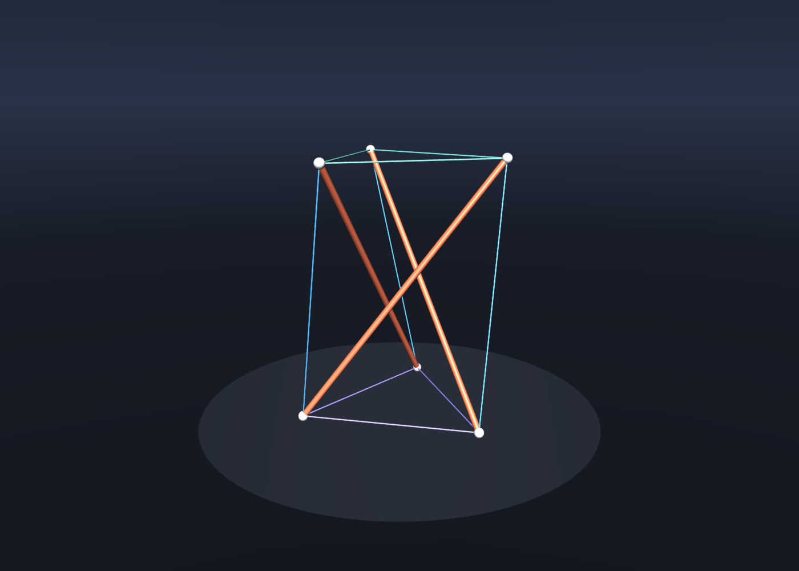

# x3d.engineering/tensegrity

Study C of [ENGINEERING-PLAYBOOK.md](../../ENGINEERING-PLAYBOOK.md) (28 November 2026): a three-strut tensegrity prism designed for a load, and the six-strut classic, both from one matrix. **A worked study, not for construction.** Material values are recalled from memory and graded on the card. Every number is measured by the thread that built it and stays Likely until a second reader recomputes it (law 44).



## What it answers

| Question | Answer | Where |
|---|---|---|
| Where does the shape come from? | The equilibrium matrix loses rank at one twist only: 150° for 3 struts (90° + 180°/n), for any height or radius | `results/bank.json` `twist` |
| Why does it stand? | At that twist there is 1 self-stress state and 1 mechanism (Maxwell's count 0 = 1 − 1). Prestress gives the mechanism its stiffness: 1.63 N/m per N, 0 at 0 N | `stiffness` |
| Does a 1 m prism carry 800 N? | Yes between 489 N and 1,114 N of prestress in each side cable; designed at 600 N with struts at 0.78 of the buckling allowance and cables at 0.77 of the strength allowance | `envelope`, `window`, `design` |
| What about the six-strut classic? | Parallel struts half a strut apart, cables 0.612 of a strut, strut force √6 times cable force, same census | `six` |

Result: **17 of 17 gates, 17 of 17 controls caught** (`results/verdict.json`). Receipt: `runs/engineering-tensegrity-20261128/`.

## Run it

```sh
export LOOM_FORK=/path/to/x3d_mcp          # the validator checkout
x3d.engineering/accept.sh tensegrity       # needs numpy and Node 22; about a minute
```

## Files

| File | What |
|---|---|
| `card.json` | 7 requirements, 9 references, 14 load cases, the prestress envelope, 17 controls, the limits (written before the run of record) and the exploration that came first |
| `tensegrity.py` | the mathematics: shapes, equilibrium matrix and its SVD, force-density matrix, tangent stiffness, load-stepped Newton, dynamic relaxation, the design checks |
| `build.py` | every stated number into `results/bank.json`, and the three scenes |
| `scenes.py` | X3D 4.0 writers and the reader that joins a scene back to the bank |
| `check.py` | the witness: every gate recomputed, every control required to fail the gate it names; writes `results/verdict.json` and `results/loss.json` |
| `page/solver.js`, `page_solver_check.js` | the teaching page's solver and its check against the bank (`results/page-solver.json`) |
| `page/` | the teaching page: `template.html` + `app.js` + `solver.js` assembled by `build_page.py` into `index.html`, with every quoted number copied from the bank and the verdict |
| `scenes/prism.x3d` | the design at rest; each member carries length, prestress, worst force, capacity and utilisation as metadata |
| `scenes/prism-press.x3d` | the 0 to 800 N press played by interpolators from 17 static solutions |
| `scenes/six-strut.x3d` | the six-strut tensegrity standing on one cable triangle |

## Things worth knowing

- **No physics engine runs anywhere here.** The scenes are geometry, names, metadata and keyframes. X3D 4.0 has no rope, spring or distance-limit joint, so a tensegrity cannot be written as X3D physics (`results/loss.json`).
- **The page's solver is a second implementation**, not a copy of the numpy one: dynamic relaxation in plain JavaScript, with the prestress from the closed-form force densities. It agrees with the bank to under 1e-9 m on five load cases, and a wrong prestress pattern misses by 1.3 mm.
- **Cables are drawn at twice their true diameter** in the scenes (and a little more on the page). The scene descriptions say so.
- The page loads X_ITE 16.5.1 from jsDelivr and carries a trimmed copy of X_ITE's stylesheet (`page/xite-16.5.1.css`), because a viewer that blocks the CDN stylesheet leaves the 3D surface hidden. X_ITE is MIT licensed, copyright 2009 Holger Seelig and other contributors.
