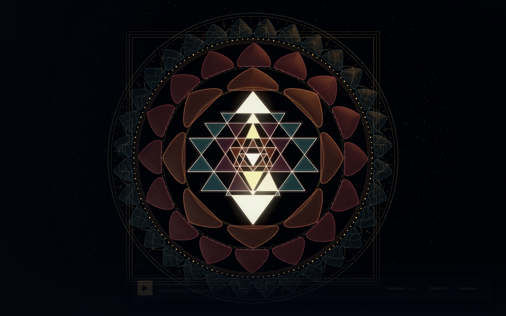

# Edition 2.0 · The Chamber Harp

Edition 1.0 made a measured Sri Yantra breathe with light and sound. Edition 2.0 makes it **playable** without moving a single canonical vertex. Every chamber is an instrument key, every touch teaches one fact about the construction, and the transport walks the figure as a pilgrimage from the outer ring to the bindu.

## What is new

| Feature | How it works | Where |
|---|---|---|
| **43-chamber harp** | One X3D `TouchSensor` in the front yantra layer reports `hitPoint_changed` in yantra units (R = 1). `locate()` finds the chamber by point-in-triangle over `YANTRA.faces`. An invisible R = 1 plate behind the chambers makes the gaps pickable too. | `src/chambers.js`, `src/scene.js`, `src/app.js` |
| **Bell voices** | Each strike is a soft bell: the fundamental plus the 2.756 and 5.404 partials of a free plate, through the same filter, delays, reverb and master-gain ceiling as 1.0. At most 10 strike voices; silent until the listener opts in and while the transport is held. | `ResonanceAudio.strike()` in `src/audio.js` |
| **Symmetry is the tuning rule** | The 43 chambers fall into 26 bilateral classes (1 + 5 + 6 + 6 + 8 by ring). Mirror chambers share a pitch. Classes climb a pentatonic scale about three octaves from the outer ring (2 × root) to the bindu (16 × root). Pan follows the chamber's x position. | `mirrorClasses()`, `chamberVoices()` |
| **Coverage made visible** | A strike lights the chamber and the triangles that cover it: the bindu triangle lights all nine, an outer chamber one. A touch on a gap reports its even coverage and why it is not one of the 43. | 9 `TriangleLight` ribbons, 43 `ChamberLight` fills |
| **Inward spiral** | On every half-beat the next chamber of an inward spiral (outer ring first, clockwise from the top) lights. The light field is a pure function of the musical beat. When the spiral reaches the bindu, sparks rise from it. Studio › *Pulse voice* can make the transport sing the chamber pitches instead of the authored plucks. | `spiralOrder()`, `spiralLights()`, `lastArrival()` |
| **Resonance wave** | Space sends light outward from the bindu chamber by chamber, flashes all nine triangles, and bursts 30 sparks. | `harpLights()` |
| **Sparks** | 60 gem-shaped sparks (the pearl octahedron) in a pool. Each is a `Transform` over a USE'd shape, so the scene's rule holds: only transforms and materials move. Poses are closed-form (drag-damped flight, shrinking gem). | `src/sparks.js` |
| **Halo bloom** | X_ITE 16.8.0 has tone mapping and exposure but no bloom. Two down-sampled copies of the frame (1/4, then 1/10 of the first) are blurred by the compositor and screen-blended. The bloom brightens with the pulse and the measured audio level (AnalyserNode RMS). | `src/bloom.js` |
| **Bloom governor** | Copying the frame stalls software renderers. Bloom starts off when the WebGL renderer is SwiftShader, llvmpipe or similar, and switches itself off if the median frame passes 30 ms over 90 frames. | `softwareRenderer()`, `Bloom._govern()` |
| **Immersive centring** | `H` now recentres the yantra and widens the view slightly, instead of keeping the 1.0 desktop offset. | `frameView()` |
| **Keys 1–5** | Strike a whole ring as a rolled chord (bindu to outer ring). | `strikeRing()` |

## Invariants kept

- `YantraCoordinates` is byte-identical to 1.0 and to `YANTRA.triangles` (test `2.0 scene adds ...`); the browser gate compares the live point field before and after every click, key and resonance.
- The native audit still reads the live point field at 10⁻⁷ R.
- Still texture-free and script-free X3D: no `ImageTexture`, `Script` or `ParticleSystem` (that component is not in the vendored runtime; see the gaps log).
- The 1.0 transport, plucks and clock handover are unchanged unless the listener picks the chamber melody.

## Numbers (each names its instrument)

| Measure | Value | Instrument |
|---|---|---|
| Node tests | 25 / 25 pass (18 from 1.0, 7 new) | `node --test test/*.test.mjs` |
| Python tests | 5 / 5 pass | `python3 -m unittest discover -s test -p 'test_*.py'` |
| X3D gate, built scene | pass, XSD 4.0, 0 errors, 0 warnings, 169 info (unused-def, no-viewpoint) | `tools/validate_x3d.py`, pinned x3d_mcp `b5c9956`, `docs/native-validation.json` |
| X3D gate, live browser export | pass, XSD 4.1, 0 errors, 0 warnings | same |
| Upstream UI and audio witnesses | pass | `tools/check_browser.py`, `tools/check_audio_browser.py` (Chromium 153.0.8010.12, SwiftShader) |
| Harp gate, source and standalone | 22 / 22 checks pass | `tools/check_harp_browser.mjs`, `docs/harp-browser-2.0.json` |
| Real clicks that hit the right chamber | 5 / 5 per target (Chambers 33, 40, 25, 12, 01) | harp gate |
| Independent interior samples located in their own chamber | 43 / 43 | `test/harp.test.mjs` against `data/independent-arrangement.json` |
| Scene | 87 shapes, 3,753,964 bytes (1.0: 34 shapes, 3,712,579 bytes) | `createArtwork().stats` |
| Standalone | 2,201,910 bytes, 11 modules, 37 assets | `node tools/build.mjs` |
| Frame rate, SwiftShader at 1280 × 800 | 1.0: 6.7 fps; 2.0 bloom off: 7.2 fps; 2.0 bloom on: 3.0 fps | `S.frame` over 3 s; software GL only, not a GPU number |

The SwiftShader frame rates are why the governor exists. No real-GPU frame rate has been measured; see the gaps log.
